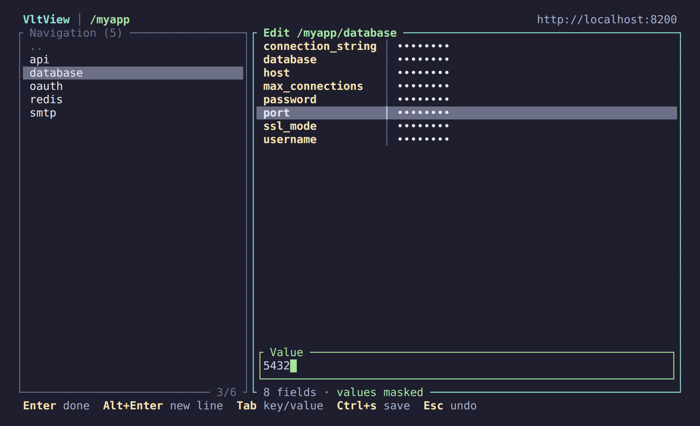
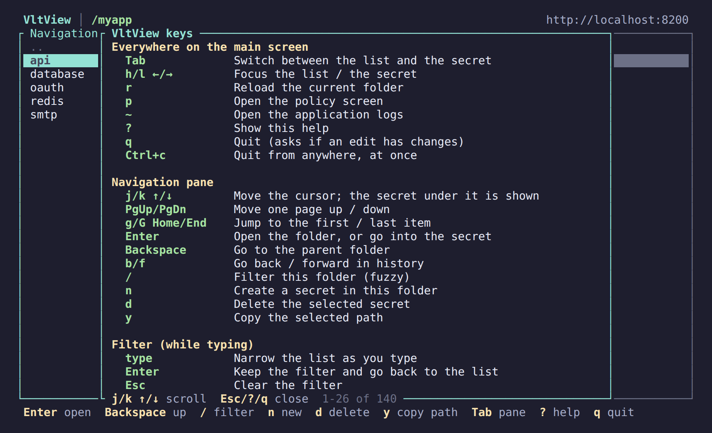

# ⚙️ VltView

Terminal UI application for browsing and managing HashiCorp Vault secrets.

## Features

- Browse Vault KV secrets with an intuitive tree navigation
- View and search secret keys and values
- Copy secrets to clipboard
- View and manage Vault policies
- Filter and search functionality
- Async operations with loading states
- Real-time log monitoring
- Support for Vault Enterprise namespaces

## Screenshots

### Navigation View

*Browse Vault KV secrets with tree navigation*

### Secret Details

*View secret keys and values with masked display*

### Edit Secret

*Edit secrets with multi-line support*

### Version History

*Browse and restore previous secret versions (KV v2)*

### Help Overlay

*Quick access to all keyboard shortcuts*

### Application Logs

*Real-time log monitoring for debugging*

## Architecture

VltView follows a layered component-based architecture:

```
┌─────────────────────────────────────────┐
│            TUI Layer (UI)               │
│  ┌────────────────────────────────────┐ │
│  │  Root Component (Screen Manager)   │ │
│  │  ├─ Browser Screen                 │ │
│  │  ├─ Detail Screen                  │ │
│  │  ├─ Policy Screen                  │ │
│  │  └─ Help Overlay                   │ │
│  └────────────────────────────────────┘ │
└─────────────────────────────────────────┘
              ↕ Actions
┌─────────────────────────────────────────┐
│        App Layer (Business Logic)       │
│  ├─ NavigationController               │
│  ├─ SecretService                      │
│  ├─ PolicyService                      │
│  └─ FilterEngine                       │
└─────────────────────────────────────────┘
              ↕ API Calls
┌─────────────────────────────────────────┐
│      Vault Client (HTTP API)            │
│  ├─ Auth (Token, AppRole, etc.)        │
│  ├─ KV v1/v2 Operations                │
│  └─ Policy Operations                  │
└─────────────────────────────────────────┘
```

### Key Modules

- **`tui`**: Terminal UI layer using Ratatui, component-based architecture with action/event handling
- **`app`**: Business logic layer with service-oriented design (navigation, secrets, policies)
- **`vault`**: Vault API client with async HTTP operations (reqwest + tokio)
- **`state`**: Shared application state management with Arc/RwLock
- **`config`**: Configuration management (file, env vars, CLI args)
- **`clipboard`**: Cross-platform clipboard integration

## Installation

### From Source

Requires Rust 1.100 or newer. The exact toolchain is pinned in `mise.toml`;
with [mise](https://mise.jdx.dev) installed, `mise install` sets it up.

```bash
mise install            # optional: pinned Rust toolchain
cargo build --release
sudo cp target/release/vltview /usr/local/bin/
```

### Using Cargo

```bash
cargo install --path .
```

## Usage

### Basic Usage

```bash
# Connect using environment variables
export VAULT_ADDR=http://localhost:8200
export VAULT_TOKEN=your-token
vltview

# Or use CLI flags
vltview --vault-addr http://localhost:8200 --vault-token your-token

# Start at a specific path
vltview secret/data/myapp

# With config file
vltview --config ~/.vltview.yaml
```

### Configuration File

`~/.vltview.yaml` is read if it exists; `--config FILE` names another file.
Every key is optional:

```yaml
vault_addr: http://localhost:8200
vault_token: your-token
vault_namespace: admin  # Vault Enterprise only
insecure: false         # true skips TLS certificate verification, like --insecure
timeout_secs: 30        # request timeout
```

| Key | Environment | Command line | Default |
|-----|-------------|--------------|---------|
| `vault_addr` | `VAULT_ADDR` | `--vault-addr` | none, required |
| `vault_token` | `VAULT_TOKEN` | `--vault-token` | contents of `~/.vault-token` |
| `vault_namespace` | `VAULT_NAMESPACE` | `--vault-namespace` | none |
| `insecure` | `VAULT_SKIP_VERIFY` (`1` or `true`) | `--insecure` | `false` |
| `timeout_secs` | | | `30` |

A value on the command line wins over the environment, which wins over the
file. The file may hold only some of the values, for example the address,
with the token coming from `VAULT_TOKEN`.

A file that is not valid YAML, or that has a key not listed here, stops the
start with an error naming the file and the problem. `cache_enabled` and
`cache_ttl` are accepted for compatibility and have no effect.

### Key Bindings

The footer always shows the keys that work where you are, and `?` lists all
of them. The main ones:

| Where | Key | Action |
|-------|-----|--------|
| Anywhere | `Tab`, `h`/`l` | Switch between the list and the secret |
| | `r` | Reload the current folder |
| | `p` / `~` | Policies / application logs |
| | `?` | Help |
| | `q`, `Ctrl+C` | Quit |
| List | `↑/↓` or `j/k`, `PgUp/PgDn`, `g/G` | Move; the secret under the cursor is shown |
| | `Enter` | Open the folder, or go into the secret |
| | `Backspace` | Parent folder |
| | `/` | Filter the folder (`Esc` clears) |
| | `n` / `d` | New secret / delete secret |
| | `y` | Copy the path |
| Secret | `Space` / `v` | Reveal the selected value / every value |
| | `Enter` | Show the whole value |
| | `c` | Copy the selected value |
| | `e` | Edit |
| | `l` | Version history |
| Editor | `Enter` | Edit the value; in a field, done |
| | `Alt+Enter`, `Ctrl+J` | Line break in a value |
| | `r` / `a` / `d` | Rename key / add field / delete field |
| | `Ctrl+S` | Save the secret |
| | `Esc` | Discard the field being typed, or close the editor |

Moving the cursor onto a secret reads it from Vault once the cursor rests
there, so scrolling through a folder does not read every secret on the way.

## Development

### Toolchain

Tool versions (Rust, rustfmt, clippy, cargo-audit) are pinned in `mise.toml`
and used by CI and the release workflow.

```bash
mise install     # install the pinned toolchain
mise run ci      # format check, clippy, tests, dependency audit
```

### Run Tests

```bash
cargo test
```

### Run with Debug Logging

```bash
vltview --debug
```

### Docker Development Environment

```bash
# Start Vault dev server
docker-compose up -d

# Initialize Vault with test data
./vault-init.sh

# Run vltview
cargo run
```

## License

MIT

## Contributing

Contributions welcome! Please open an issue or PR.
