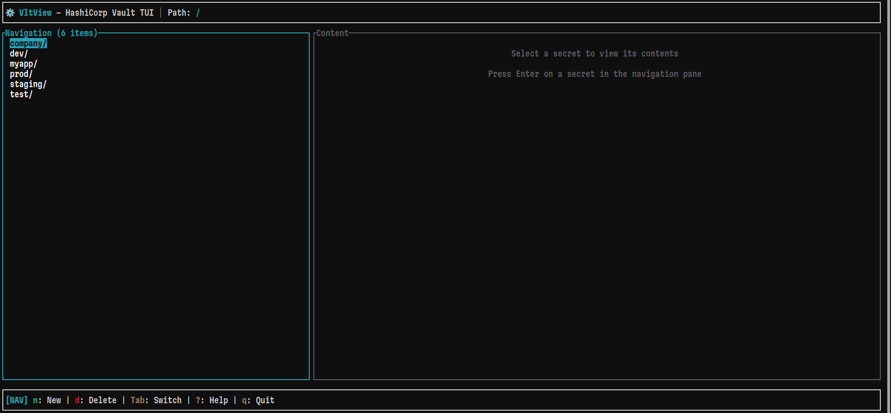
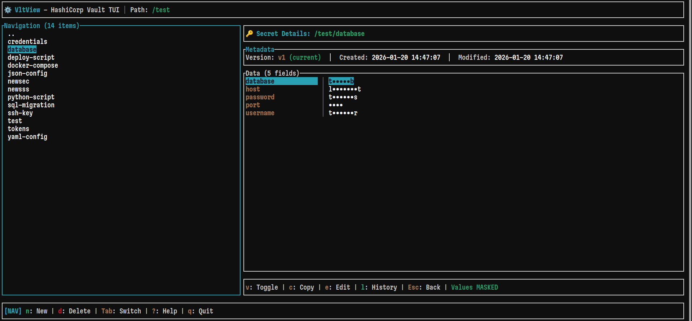
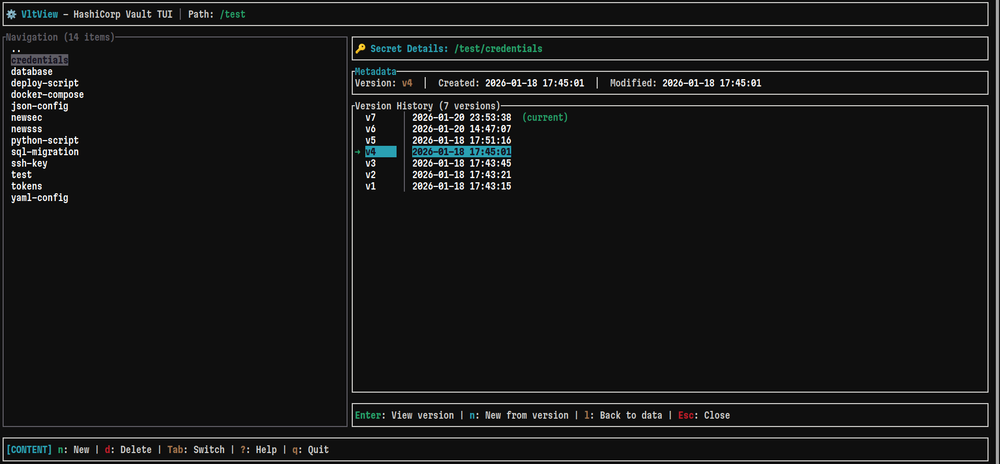
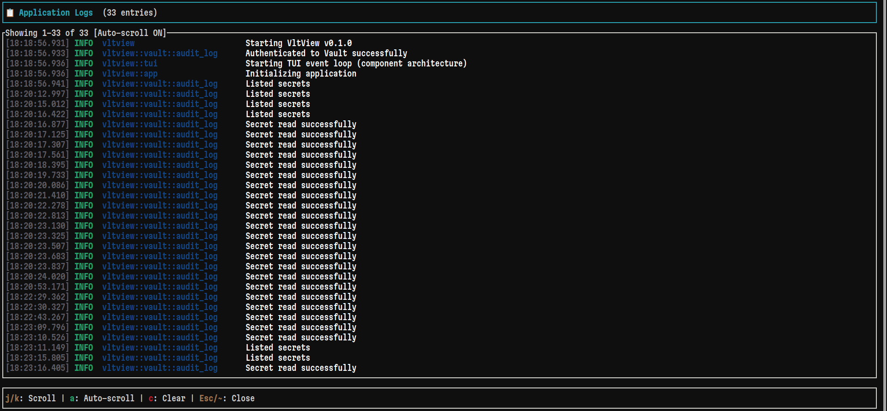

# ⚙️ VltView

Terminal UI application for browsing and managing HashiCorp Vault secrets.

## Features

- Browse Vault KV secrets with an intuitive tree navigation
- View and search secret keys and values
- Copy secrets to clipboard
- View and manage Vault policies
- Filter and search functionality
- Async operations with loading states
- Real-time log monitoring
- Support for Vault Enterprise namespaces

## Screenshots

### Navigation View

*Browse Vault KV secrets with tree navigation*

### Secret Details

*View secret keys and values with masked display*

### Edit Secret

*Edit secrets with multi-line support*

### Version History

*Browse and restore previous secret versions (KV v2)*

### Help Overlay

*Quick access to all keyboard shortcuts*

### Application Logs

*Real-time log monitoring for debugging*

## Architecture

VltView follows a layered component-based architecture:

```
┌─────────────────────────────────────────┐
│            TUI Layer (UI)               │
│  ┌────────────────────────────────────┐ │
│  │  Root Component (Screen Manager)   │ │
│  │  ├─ Browser Screen                 │ │
│  │  ├─ Detail Screen                  │ │
│  │  ├─ Policy Screen                  │ │
│  │  └─ Help Overlay                   │ │
│  └────────────────────────────────────┘ │
└─────────────────────────────────────────┘
              ↕ Actions
┌─────────────────────────────────────────┐
│        App Layer (Business Logic)       │
│  ├─ NavigationController               │
│  ├─ SecretService                      │
│  ├─ PolicyService                      │
│  └─ FilterEngine                       │
└─────────────────────────────────────────┘
              ↕ API Calls
┌─────────────────────────────────────────┐
│      Vault Client (HTTP API)            │
│  ├─ Auth (Token, AppRole, etc.)        │
│  ├─ KV v1/v2 Operations                │
│  └─ Policy Operations                  │
└─────────────────────────────────────────┘
```

### Key Modules

- **`tui`**: Terminal UI layer using Ratatui, component-based architecture with action/event handling
- **`app`**: Business logic layer with service-oriented design (navigation, secrets, policies)
- **`vault`**: Vault API client with async HTTP operations (reqwest + tokio)
- **`state`**: Shared application state management with Arc/RwLock
- **`config`**: Configuration management (file, env vars, CLI args)
- **`clipboard`**: Cross-platform clipboard integration

## Installation

### From Source

```bash
cargo build --release
sudo cp target/release/vltview /usr/local/bin/
```

### Using Cargo

```bash
cargo install --path .
```

## Usage

### Basic Usage

```bash
# Connect using environment variables
export VAULT_ADDR=http://localhost:8200
export VAULT_TOKEN=your-token
vltview

# Or use CLI flags
vltview --vault-addr http://localhost:8200 --vault-token your-token

# Start at a specific path
vltview secret/data/myapp

# With config file
vltview --config ~/.vltview.yaml
```

### Configuration File

Create `~/.vltview.yaml`:

```yaml
vault_addr: http://localhost:8200
vault_token: your-token
vault_namespace: admin  # Optional, for Enterprise
insecure_skip_verify: false
```

### Key Bindings

| Key | Action |
|-----|--------|
| `↑/↓` or `j/k` | Navigate items |
| `Enter` | Select/Open item |
| `Backspace` | Go back |
| `Tab` | Switch between list/detail |
| `p` | View policies |
| `/` | Search/Filter |
| `c` | Copy value to clipboard |
| `r` | Refresh current view |
| `?` | Show help |
| `q` | Quit screen |
| `Ctrl+C` | Quit application |

## Development

### Run Tests

```bash
cargo test
```

### Run with Debug Logging

```bash
vltview --debug
```

### Docker Development Environment

```bash
# Start Vault dev server
docker-compose up -d

# Initialize Vault with test data
./vault-init.sh

# Run vltview
cargo run
```

## License

MIT

## Contributing

Contributions welcome! Please open an issue or PR.
